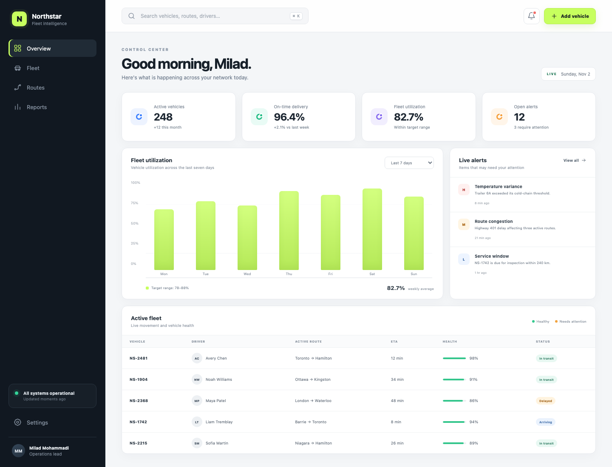

# Northstar Ops

**Live demo:** [https://miladmo68.github.io/northstar-ops-dashboard/](https://miladmo68.github.io/northstar-ops-dashboard/)

Northstar Ops is a responsive fleet-intelligence dashboard built for operations teams that need a fast view of vehicle health, route performance, utilization, and service risk.

## Highlights

- Responsive control-center interface for desktop, tablet, and mobile
- Live fleet search across vehicle IDs, drivers, routes, and statuses
- Interactive utilization overview and operational alert feed
- Vehicle health, ETA, and delivery-status monitoring
- Add-vehicle workflow with session-based state
- Accessible controls, keyboard-friendly inputs, and reduced-motion support
- Static production export with automated GitHub Pages deployment

## Technology

- Next.js 16 with App Router
- React 19 and TypeScript
- CSS design system with responsive breakpoints
- JSON-backed operational dataset
- GitHub Actions and GitHub Pages

## Architecture

The dashboard uses a statically exported Next.js application for reliable hosting on GitHub Pages. Operational records are loaded from a structured JSON dataset, while temporary changes use browser session storage. The deployment workflow runs type checking and a production build before publishing the generated static output.

## Local development

```bash
npm install
npm run dev
```

Production verification:

```bash
npm run typecheck
npm run build
```

## Project report

Build and release details are recorded in [PROJECT_REPORT.md](./PROJECT_REPORT.md).
